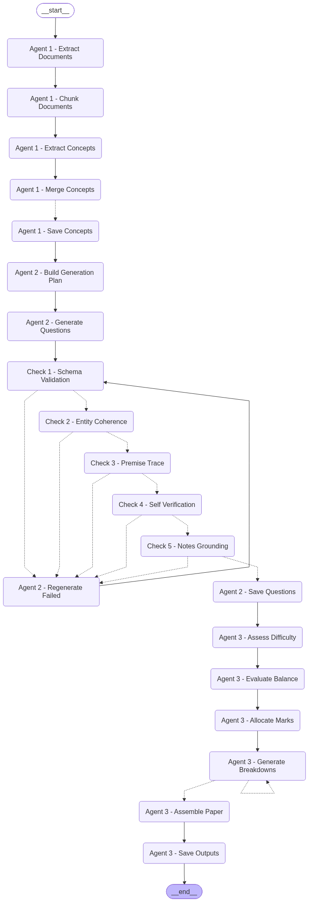

# Classroom Agent — AI Question Paper Generator

**Give it your course notes, get back an exam.** Classroom Agent reads lecture notes and syllabus files (PDF, DOCX), pulls out the key concepts, writes MCQ, coding and theory questions, checks every question for correctness, and produces a ready-to-print question paper with a full marking scheme.

It is a **multi-agent pipeline built with LangGraph**: three agents with separate jobs, connected as a state graph with automatic retries and checkpointing so a run can resume after a failure.

---

## What it produces

From one run you get:

| File | What it is |
|---|---|
| `outputs/question_paper.txt` | Student-facing exam paper, split into sections with marks per question |
| `outputs/marking_scheme.txt` | Examiner's marking guide with a mark breakdown for each answer |
| `outputs/final_quiz.json` | The full quiz as structured data |
| `outputs/questions.json` | Every verified question, with its source concept and verification status |
| `outputs/concepts.json` | Concepts extracted from the course material |

Example output from a Data Structures course is already in [`outputs/`](outputs/) — see [`question_paper.txt`](outputs/question_paper.txt) and [`marking_scheme.txt`](outputs/marking_scheme.txt).

## How it works



### Agent 1 — Concept Extractor
Reads each PDF/DOCX, splits it into overlapping chunks while keeping track of the real page numbers, extracts concepts from every chunk with the LLM, and merges duplicates across chunks and files.

### Agent 2 — Question Writer
Plans a balanced mix of **MCQ**, **CODE** and **THEORY** questions, generates them in batches, then runs every question through **five quality checks**:

1. **Schema** — is the structure valid? (Pydantic v2 models)
2. **Coherence** — can the question actually be answered as written?
3. **Premise** — is what the question claims actually true?
4. **Verification** — the model solves the question blind and the answer is compared with the marked answer.
5. **Grounding** — is the answer consistent with *this* course's material, not just correct in general?

A question that fails any check is sent back to be regenerated. Questions that still can't be verified are flagged for the teacher to review instead of being silently included.

### Agent 3 — Examiner
Rates each question's difficulty (Easy / Medium / Hard), reports how balanced the paper is, allocates marks from a fixed table, writes an itemized marking scheme, and formats the final paper.

| Marks | Easy | Medium | Hard |
|---|---|---|---|
| MCQ | 1 | 2 | 3 |
| Code | 4 | 6 | 8 |
| Theory | 4 | 6 | 10 |

## Tech stack

- **Python 3.10+**
- **LangGraph** — state graph orchestration, conditional retry edges, SQLite checkpointing
- **Groq** (`openai/gpt-oss-120b`, `llama-3.3-70b-versatile`) or **OpenAI** as the LLM provider
- **Pydantic v2** — strict schemas for concepts and questions
- **pypdf** and **python-docx** — document extraction

## Setup

```bash
git clone https://github.com/KathanJain2007/classroom-agent.git
cd classroom-agent
python -m venv .venv
source .venv/bin/activate        # Windows: .venv\Scripts\activate
pip install -r requirements.txt
```

Create a `.env` file in the project folder with **one** of these keys:

```
GROQ_API_KEY=your_groq_key
# or
OPENAI_API_KEY=your_openai_key
```

If both are set, OpenAI is used. A free Groq key is enough to run the whole pipeline.

## Usage

```bash
# Generate a paper from one or more files
python main.py unit1.pdf unit2.pdf notes.docx

# Or from every PDF/DOCX directly inside a folder
python main.py path/to/your/notes/

# Choose how many questions to generate (default 12)
python main.py path/to/your/notes/ --questions 6

# Continue an interrupted run from the last checkpoint
python main.py --resume

# Save the pipeline diagram to outputs/pipeline_graph.png
python main.py --visualize
```

## Project structure

```
├── main.py              # Command-line entry point
├── pipeline.py          # LangGraph graph: nodes, edges, retry routing, checkpointing
├── pipeline_state.py    # Shared state passed between nodes
├── extractors.py        # PDF/DOCX text extraction and chunking
├── step1_test.py        # Agent 1 + LLM client setup and model selection
├── agent2.py            # Agent 2: question generation and the five quality checks
├── agent3.py            # Agent 3: difficulty, marks, marking scheme, paper formatting
├── schemas.py           # Pydantic models for concepts, questions and the quiz
├── validate_schema.py   # Schema validation helpers
├── sample_pdfs/         # One small sample input (Double Ended Queue notes)
└── outputs/             # Generated files (example output included)
```

## Author

[Kathan Jain](https://github.com/KathanJain2007)
